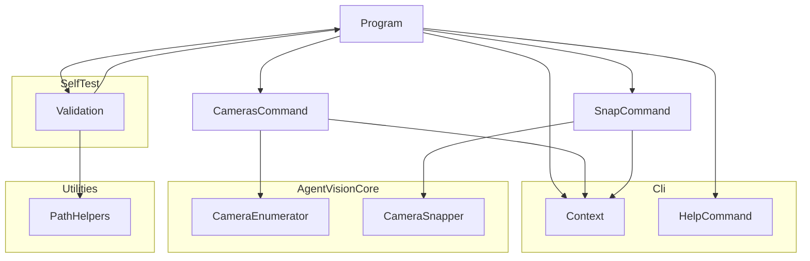

# AgentVisionTool

## Architecture

The AgentVisionTool system is the `agentvision` command-line application built on .NET. It is the thin
front-end of the AgentVision product: it handles arguments, output, exit codes, help, and self-validation, and
calls the *AgentVisionCore* library for everything to do with cameras, which never depends on the tool. It is
structured as one system containing three top-level units (`Program`, `CamerasCommand`, and `SnapCommand`) and
three subsystems (`Cli`, `SelfTest`, `Utilities`):

`Program` is the entry point. It first offers the arguments to `HelpCommand`, which answers the
`help` command from the built-in help cards; otherwise it creates a `Context` from the `Cli`
subsystem, dispatches to `Validation` when `--validate` is passed, to `CamerasCommand` when the
`cameras` command is given, or to `SnapCommand` when the `snap` command is given, and returns the exit code
from `Context`. `CamerasCommand` prints the cameras that the library's `CameraEnumerator` lists.
`SnapCommand` maps the options to a request for the library's `CameraSnapper`, which opens the camera, saves one
picture, and closes the camera, and reports the result or the error. `Validation` calls `Program.Run` recursively to
exercise the tool during self-testing, and uses `PathHelpers` to construct safe temporary file paths.

## External Interfaces

**Command-Line Interface**: The primary input interface for tool invocation.

- *Type*: CLI.
- *Role*: Consumer (the host environment invokes the system with command-line arguments).
- *Contract*: Accepts the `help` command as the first argument (see Help Command below), or the
  `cameras` or `snap` command, which may stand among the options, and the
  arguments `-v`/`--version`, `-?`/`-h`/`--help`, `--silent`, `--validate`,
  `--results <file>`, `--result <file>` (legacy alias for `--results`), `--depth <n>`, and
  `--log <file>`; the `snap` command also takes `--camera <index|id|name>`, `--output <file>`,
  `--crop <x,y,w,h>`, `--width <px>`, `--height <px>`, `--fps <n>`, and `--warmup <ms>`. Returns exit code 0
  for success and 1 for failures. The `cameras` command returns 0 also when no camera is found; the `snap`
  command returns 0 only when the picture was saved.
- *Constraints*: Unknown arguments, a command given twice, the `cameras` and `snap` commands together, a `snap`
  option without the `snap` command, a `snap` command without `--camera` or `--output`, and invalid option
  values cause exit code 1 and an error message on stderr. Argument
  errors are found before `--silent` and `--log` take effect, so they are always printed and never
  logged.

**Help Command**: Built-in help, answered from help cards embedded in the tool assembly.

- *Type*: CLI.
- *Role*: Provider.
- *Contract*: `agentvision help` prints the topic index and `agentvision help <topic>` prints a
  topic card with its examples; HelpCards adds `--example`, `--search`, and `--json`. Returns exit
  code 0 for success, 2 for a wrong help argument or an unknown topic, and 70 for a defective card
  catalog.
- *Constraints*: `help` must be the first argument. It is answered before the options are parsed,
  so `--silent` and `--log` do not apply and no banner is printed.

**Standard Output**: Normal program output written to `Console.Out`.

- *Type*: Standard I/O.
- *Role*: Provider.
- *Contract*: Writes version, banner, help text, the camera list, the saved-picture line, validation summary, or the
  default guidance message depending on the flags and command provided. Suppressed when `--silent` is active; the log
  file still receives all output.
- *Constraints*: Human-readable text; no machine-parseable format contract.

**Standard Error**: Error message output written to `Console.Error`.

- *Type*: Standard I/O.
- *Role*: Provider.
- *Contract*: Writes error messages in red when a failure occurs, including the camera, file, and crop errors of
  the `snap` command. Suppressed when `--silent`
  is active but the exit code is still set to 1.
- *Constraints*: Color output requires a terminal that supports `ConsoleColor`.

**Picture File**: The file that the `snap` command writes.

- *Type*: File.
- *Role*: Provider.
- *Contract*: When the `snap` command succeeds, `--output <file>` holds one picture of the camera in the
  format that the extension (`.png`, `.jpg`, `.jpeg`, `.bmp`) chooses, cropped when `--crop` was given.
  An existing file is overwritten.
- *Constraints*: The folder must exist. When the command fails, no new file is written.

**Log File**: Optional persistent output file.

- *Type*: File.
- *Role*: Provider.
- *Contract*: When `--log <file>` is supplied, all `Context.WriteLine` and `Context.WriteError`
  output is written to the file regardless of `--silent`. The file is truncated at open.
- *Constraints*: The path must be writable; failure to open the file raises an
  `InvalidOperationException` and causes exit code 1.

**Results File**: Optional self-validation results file.

- *Type*: File.
- *Role*: Provider.
- *Contract*: When `--results <file>` is supplied alongside `--validate`, self-validation results
  are serialized to the file. Extension `.trx` selects MSTest TRX format; `.xml` selects JUnit
  XML format.
- *Constraints*: Any other extension causes an error message and exit code 1; no file is written.

## Dependencies

- **AgentVisionCore** (the `DemaConsulting.AgentVision.Core` library, produced in this repository): the
  `CamerasCommand` unit uses its `CameraEnumerator` to list the cameras, and the `SnapCommand` unit uses its
  `CameraSnapper` to take a picture. The tool package bundles the library, and through it FlashCap (see
  *FlashCap Integration Design*) and CanvasNet (see *CanvasNet Integration Design*), which only the library uses.
- **DemaConsulting.TestResults**: provides `TestResults`, `TestResult`, and `TestOutcome` for
  accumulating self-validation results.
- **DemaConsulting.TestResults.IO**: provides `TrxSerializer` and `JUnitSerializer` for writing
  results files.
- **DemaConsulting.HelpCards**: loads, validates, and serves the built-in help cards for the
  `help` command (see *HelpCards*, the OTS integration design).

## Risk Control Measures

N/A - not a safety-classified software item.

## Data Flow

1. The host environment starts the tool process and passes command-line arguments to
   `Program.Main`.
2. `Program.Main` offers the arguments to `HelpCommand.TryRun`. When the first argument is
   `help`, the help command builds the card catalog, writes its answer to the console, and
   `Program.Main` returns its exit code. Any other first argument returns at once without
   building the catalog.
3. `Program.Main` calls `Context.Create(args)`, which parses the arguments and opens the log
   file if `--log` was specified. An `ArgumentException` or `InvalidOperationException` at
   this point is caught, written to stderr, and causes exit code 1.
4. `Program.Run(context)` inspects the parsed flags and dispatches to one handler:
   - `--version` flag → `context.WriteLine(Version)`, then return.
   - Otherwise, `PrintBanner` is called first; then:
     - `--help` flag → `PrintHelp(context)`, which ends with the pointer to the help command,
       then return.
     - `--validate` flag → `Validation.Run(context)`.
     - `cameras` command → `CamerasCommand.Run(context)`.
     - `snap` command → `SnapCommand.Run(context)`.
     - Neither → `RunToolLogic(context)`, which writes one line of guidance.
5. `Program.Main` returns `context.ExitCode` (0 if no errors were reported, 1 otherwise).

## Design Constraints

- Platform: multi-targets net10.0 and net11.0 framework compatibility specifications on Windows and Linux.
- Threading: single-threaded console application; no shared mutable state between invocations.
- Immutability: `Context` properties are set once at construction via `init` accessors and are
  read-only thereafter.
- Resource lifecycle: `Context` implements `IDisposable`; callers must dispose it to flush and
  close any open log file handle.
- Path safety: all caller-supplied path components are validated by `PathHelpers.SafePathCombine`
  before file-system use.
